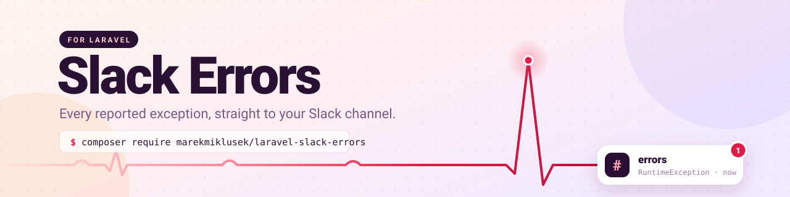

<p align="center">
  
</p>

<p align="center">
  <a href="https://github.com/marekmiklusek/laravel-slack-errors/actions"></a>
  <a href="https://packagist.org/packages/marekmiklusek/laravel-slack-errors"></a>
  <a href="https://packagist.org/packages/marekmiklusek/laravel-slack-errors"></a>
  <a href="https://github.com/marekmiklusek/laravel-slack-errors/blob/main/LICENSE.md"></a>
</p>

Install the package, add a webhook URL to `.env` and you are done. No changes to
`bootstrap/app.php`, no custom exception handler.

## Features

- ⚡ **Zero config**: hooks into the framework exception handler automatically
- 🧱 **Block Kit messages**: exception, location, URL or command, user and stack trace
- 🌍 **Environment filter** with wildcard support, `production` only by default
- 🙈 **Ignore list** on top of your application's own `dontReport`
- 🛡️ **Fail-safe**: a failing Slack call never breaks or re-enters your error handling
- 🔍 **No side effects**: the user is reported only if the app already loaded it, no extra queries

## Requirements

- PHP 8.5+
- Laravel 13+

## Installation

```bash
composer require marekmiklusek/laravel-slack-errors
```

Create an [incoming webhook](https://api.slack.com/messaging/webhooks) for your
Slack app, pick the channel and add the URL to `.env`:

```dotenv
SLACK_ERRORS_WEBHOOK_URL=https://hooks.slack.com/services/...
```

That's it. Every exception your application reports in `production` now lands in
the channel.

## Configuration

Everything is configurable through `.env`:

| Variable | Default | Description |
| --- | --- | --- |
| `SLACK_ERRORS_WEBHOOK_URL` | | Incoming webhook URL. Nothing is sent while it is empty. |
| `SLACK_ERRORS_ENABLED` | `true` | Master switch. |
| `SLACK_ERRORS_ENVIRONMENTS` | `production` | Comma separated environments, wildcards allowed (`*` for all). |
| `SLACK_ERRORS_MENTION` | | Prepended to every message, e.g. `<!channel>`, `<!here>` or `<@U012AB3CD>`. |
| `SLACK_ERRORS_TIMEOUT` | `3` | Seconds to wait for Slack. |

To ignore specific exception classes (subclasses included), publish the config:

```bash
php artisan vendor:publish --tag=slack-errors-config
```

```php
// config/slack-errors.php
'ignore' => [
    Illuminate\Validation\ValidationException::class,
],
```

Exceptions listed in your application's `dontReport` are never sent either.

## What the message contains

| Field | Value |
| --- | --- |
| Header | App name |
| Exception | Class and message |
| Location | File and line, relative to the project root |
| Environment, Host | `APP_ENV` and server hostname |
| URL, IP | HTTP method, full URL and client IP for web requests |
| Command | The artisan command for console and queue processes |
| User | ID of the authenticated user, if the request already loaded one |
| Stack trace | Up to 10 application frames, vendor frames skipped |

## How it works

- The service provider registers a `reportable` callback on the framework
  exception handler, so it runs for everything Laravel reports, including
  `report($e)` calls.
- The message is sent synchronously with a short timeout. Queues are not used on
  purpose: when something breaks, the queue or Redis is often part of the
  problem.
- Any failure while talking to Slack is swallowed, and an exception thrown while
  a report is in progress is not reported again.

## Development

| Command | What it does |
| --- | --- |
| `composer test` | Run every quality gate the CI pipeline runs |
| `composer test:unit` | Run the test suite with exactly 100% code coverage |
| `composer test:type-coverage` | Require 100% type coverage |
| `composer test:types` | Run Larastan static analysis |
| `composer test:lint` | Check code style and pending refactorings without writing files |
| `composer lint` | Apply Rector refactorings and fix code style |

## Changelog

See [CHANGELOG.md](CHANGELOG.md).

## License

The MIT License (MIT). See [LICENSE.md](LICENSE.md).
